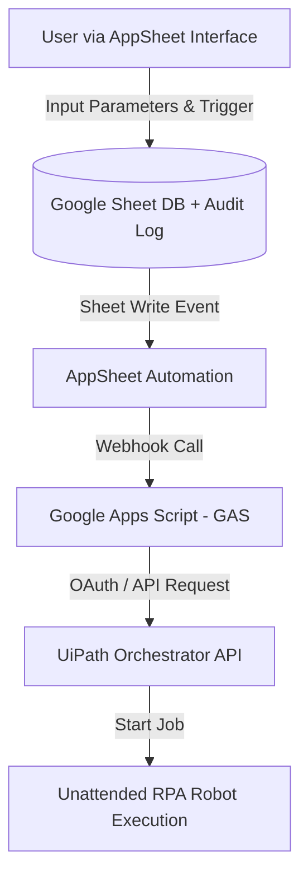
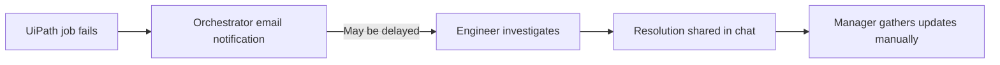
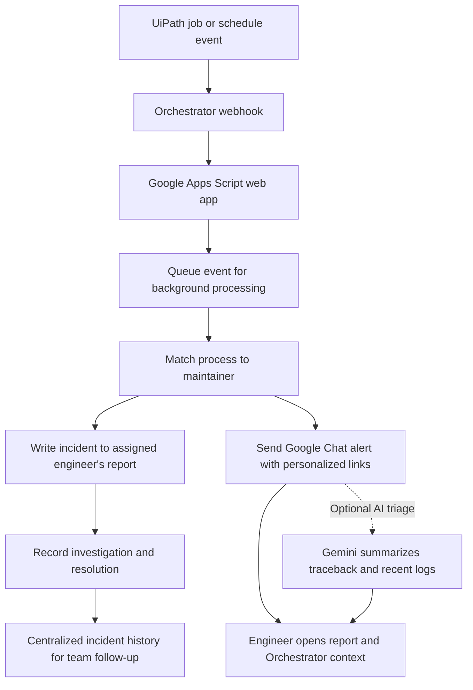

# Hi, I'm Philip Wu (Fang-Yih Wu) 👋

### AI Automation Project Coordinator | Business Integration Engineer

Grounded in quantitative cost-structure logic and hands-on enterprise automation experience, I specialize in bridging business pain points with pragmatic, decoupled tech solutions (Python, Low-Code, APIs, Generative AI).

## 💡 Featured Automation & AI Architecture Showcase

### 1. 🤖 [AI Procurement Auditing & Decision Support](https://github.com/fangyiiwu/ai_assisted_procurement-_review_workflow)

> **Structured LLM Workflow for Executive-Level Purchase Order Compliance**

* **Problem:** High-value PO reviews required tedious manual compliance checks across complex business logic, creating approval latency for C-suite decisions.

* **Solution:** Built a structured Python workflow leveraging **Pydantic** and **Gemini LLM** to extract risk insights, enforce compliance rules, and auto-generate executive decision summaries.

* **Impact:** Transformed qualitative unstructured PO data into deterministic approval recommendations for Department Heads and Senior Leadership.

### 2. 🚀 Decoupled Self-Service Automation Launcher (RPA API Portal)

> **Zero-Barrier, Decoupled Low-Code Portal for Cross-Site Ad-Hoc & Urgent Operations**

* **Business Value & Operational Impact:**

  * **Drastically Reduced Process Cycle Time:** Eliminated schedule latency and IT dependency for ad-hoc runs. Operations teams no longer need to wait for fixed time-based triggers or message engineers to manually launch jobs; they can trigger automation immediately upon data readiness.

  * **Removed IT Bottlenecks & Empowered Finance:** Transformed manual back-office triggers into an instant self-service launcher, enabling multi-site finance teams to trigger robots independently for urgent off-hours tasks and late-night month-end closings.

  * **Eliminated Software License Overhead:** Saved enterprise costs by replacing expensive proprietary attended robot user licenses with a custom, decoupled architecture (AppSheet + GAS + Orchestrator API).

  * **Zero Learning Curve:** Kept business users within their familiar Google Workspace environment, driving rapid user adoption without introducing platform fatigue.

  * **Enterprise Security & Governance:** Enforced Google Sheet ACL permission lists for role-based access control (RBAC), capturing detailed execution parameters and timestamps for a complete audit trail.

### 3. ⚡ Event-Driven AI Diagnostics & Failure Log Analyzer

> **Real-Time Webhook Pipeline with Generative AI Error Diagnostics**

* **Business Value & Operational Impact:**

  * **Bypassed Infrastructure Failures:** Switched from unreliable email notifications to real-time UiPath Orchestrator Webhooks (GAS `doPost` endpoint).

  * **Eliminated Communication Overhead:** Replaced fragmented chat updates with automated Google Sheet tracking, generating personalized deep-links for engineers to submit root-cause reports directly to management.

  * **AI Log Pre-Parsing:** Automated the extraction of raw execution logs (last 10 entries) and fed them into LLMs to immediately highlight error locations, drastically reducing engineer debugging fatigue.

#### As-Is — Delayed alert, fragmented follow-up

#### To-Be — Routed alert, shared record, faster investigation start

### 4. 📊 [Air-Gapped VBA Macro Automation](https://github.com/fangyiiwu/RPA-side-project/tree/main/VBA)

> **Agile Solution Engineering under Severe Resource Constraints**

* **Problem:** Operational bottlenecks in strict, offline/air-gapped environments with zero access to external cloud APIs or modern IDEs.

* **Solution:** Proactively engineered custom Excel VBA macro templates with user-friendly UI buttons and add-ins within 2 weeks.

* **Impact:** Reduced manual report formatting and data cleansing cycle time by **85%**.

## 📬 Connect with Me

* **LinkedIn:** [Philip Wu](https://linkedin.com/in/philip-wu-ba30591b0)

* **Email:** [fangyiiwu@gmail.com](mailto:fangyiiwu@gmail.com)
